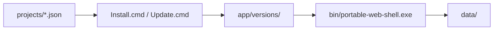

# Portable Web Shell

Reusable Windows installer and frameless Tauri shell for supported upstream Web applications.

 

<!-- SCREENSHOT PLACEHOLDER: hero image of the portable web shell running DeepSeek -->
_Screenshot coming soon._

## Features

- Reusable PowerShell installer (`Install.cmd`, `Manage.ps1`) that handles downloading, building, and verifying web applications.
- Frameless Tauri/Rust executable (`bin/portable-web-shell.exe`) providing a local application window without patching upstream source.
- Uses project recipes (`projects/deepseek.json`) to define upstream sources and build instructions.
- Completely isolated installation containing runtimes (`runtime/node`, `runtime/pnpm-<version>`), application data, caches, and logs (`data/`).
- Survives application updates; earlier revisions remain available locally in the installation folder (`app/versions/<commit>`).
- See [How it works](docs/how-it-works.md), [Startup and shutdown](docs/startup-and-shutdown.md), [Dev Note](docs/dev-note.md) and [Files and requirements](docs/files-and-requirements.md) for more details.

## Architecture

The system uses project recipes to instruct the installer on how to fetch and build a specific web application into `app/versions/<commit>`. The installer sets up the isolated runtime environment and data folders. The portable Tauri shell (`bin/portable-web-shell.exe`) then launches a contained web backend and hosts the application.

## Quick start

Requires Windows PowerShell 5.1 or later.

- **Install**: `.\Install.cmd`
- **Run**: `.\Run.cmd`
- **Update**: `.\Update.cmd`
- **Build Shell**: `.\Build-Shell.ps1` (Requires Rust and Microsoft C++ Build Tools. Rust/Tauri prerequisites are only needed to build the shell, not to run the prebuilt executable).
- **Test**: `cargo test --locked` in `shell/`, `.\Test-Wrapper.ps1`, `.\Test-Install.ps1`
- **Package**: `.\Package.ps1` (Creates the release ZIP).

See [Install and run](docs/install-and-run.md), [Update and move](docs/update-and-move.md) and [Project recipes](docs/project-recipes.md) for more info.

## Configuration

Switches are passed through the `.cmd` wrappers to `Manage.ps1` (e.g. `.\Install.cmd -Ref <tag>`).

| Setting | Purpose | Default |
| --- | --- | --- |
| `Action` | The operation to perform (Plan, Install, Update, Run, RepairShortcut, Verify) | `Install` |
| `Project` | Path to the local project recipe describing the app | `projects\deepseek.json` |
| `InstallRoot` | Destination folder for the installation | `installed\<id>` |
| `Ref` | Specific branch/tag/commit to install instead of latest | |
| `NoShortcut` | Suppresses desktop shortcut creation | `$false` |

See [Verification and recovery](docs/verification-and-recovery.md) and [Build and distribution](docs/build-and-distribution.md).

## Screenshots

<!-- SCREENSHOT PLACEHOLDER: the installer console building dependencies -->
_Screenshot coming soon._

## Roadmap

* See issues.

## License & credits

[MIT License](LICENSE)

Extracted from walladanger/deepseek-harness (portable-desktop/); see [SOURCE.md](SOURCE.md) and [THIRD-PARTY-NOTICES.txt](THIRD-PARTY-NOTICES.txt).
