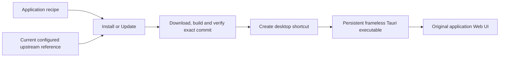

## How it works

The reusable parts are the installer scripts and compiled shell. Each application needs a recipe describing its actual installation and launch commands. The current installer supports public GitHub source archives with a root `package.json` declaring an exact pnpm version. Another runtime, private repository, or different readiness protocol requires an explicit adapter. Changing a repository name alone does not make an arbitrary application compatible.

| Action | Version behavior |
| --- | --- |
| Download the shell ZIP | Obtains the installer and shell; it contains no installed upstream app. |
| `Install.cmd` or `Update.cmd` | Resolves the configured upstream branch at that moment, downloads its exact commit, builds and verifies it, and activates it only on success. |
| Desktop shortcut or `Run.cmd` | Starts the already installed revision. It does not check for updates or download an application. |
| Install with a tag or commit in `Ref` | Uses that selected revision instead of following the latest branch. |

For DeepSeek, the tracked branch is official upstream `master`. Its latest commit can be newer than its latest published release. The selected commit is recorded in `installed.json`; commits arriving after resolution are picked up on the next Install or Update. If upstream does not build or pass the startup check, the installer reports failure and retains the previous active launch configuration.

The shell starts the application's local server, reads its announced loopback URL, and loads that original page in its own WebView. Its window controls are a separate local document. Application updates reuse the shell executable; shell implementation updates are distributed separately in this repository's releases.
