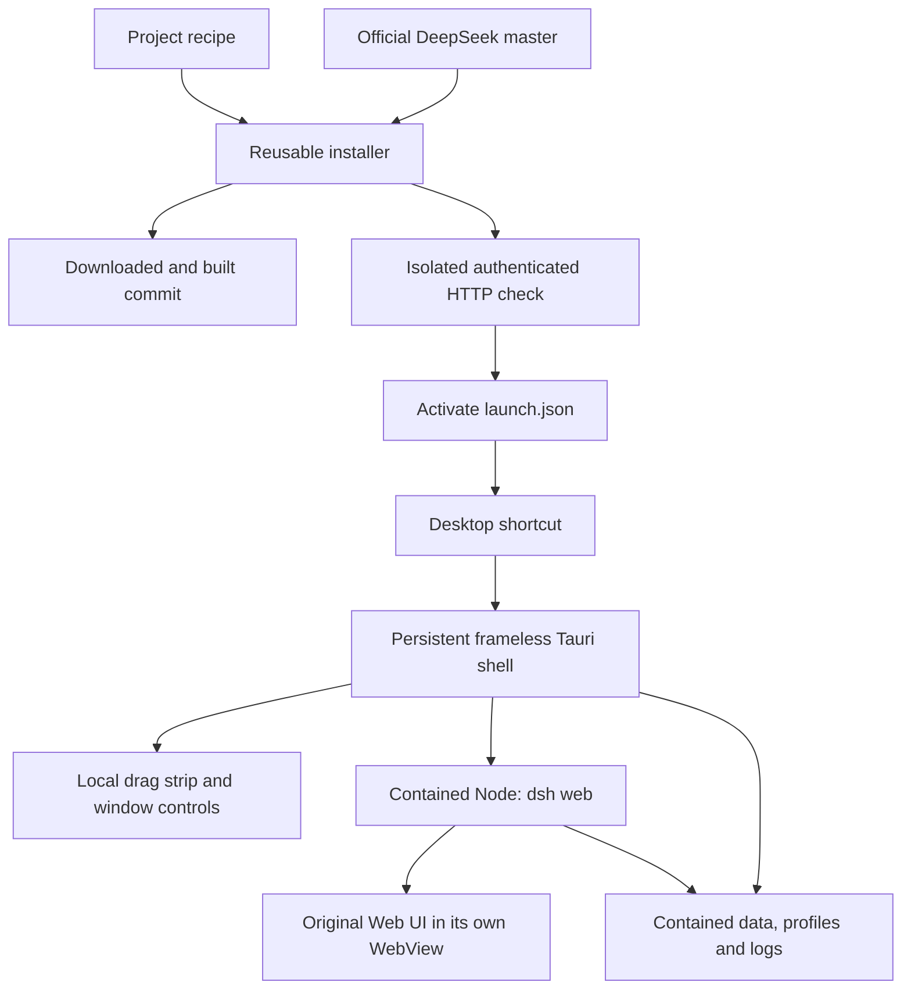
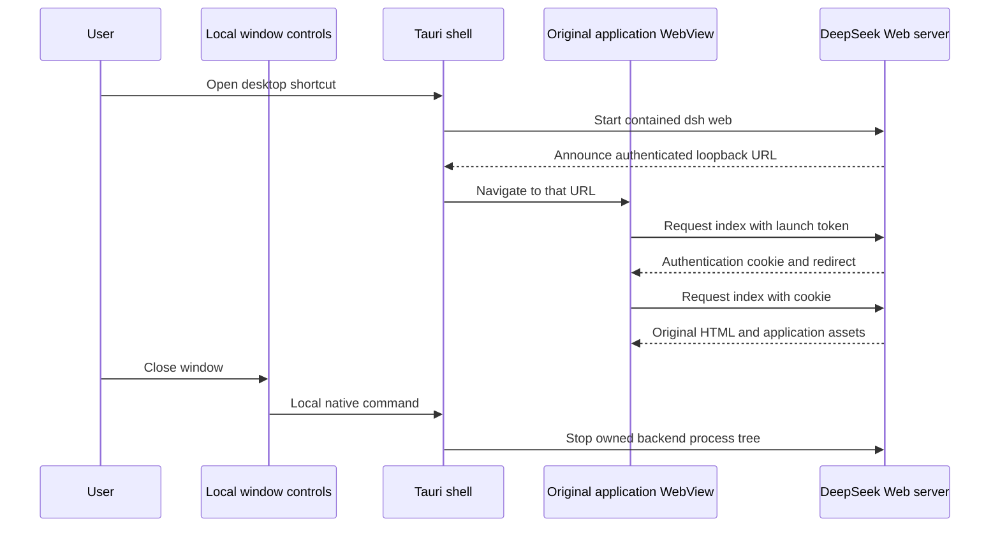
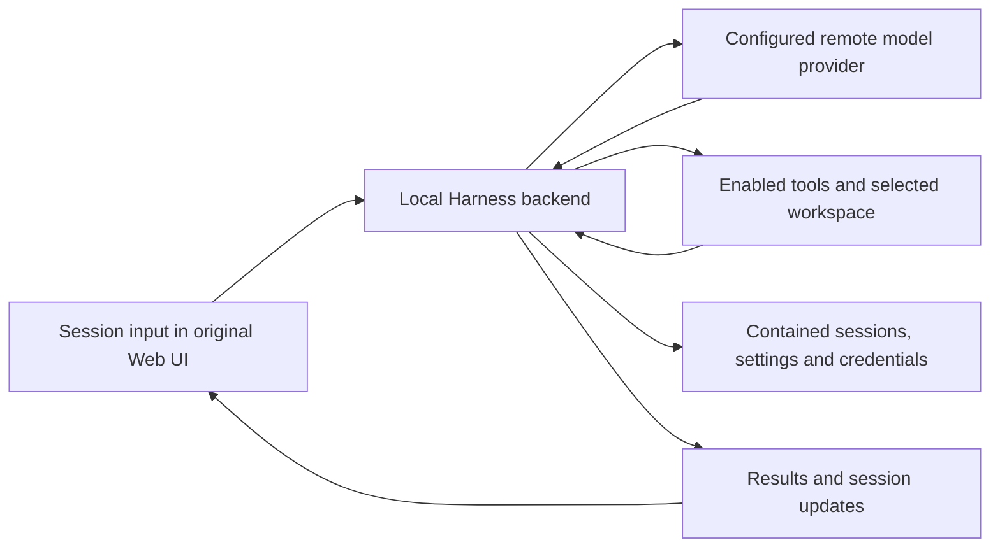

## Startup and shutdown

The window has a local title strip with drag, minimize, maximize/restore, and close controls. The app loads in a separate child WebView. No titlebar HTML, JavaScript, or CSS is inserted into DeepSeek's document. Only the local chrome can invoke native window actions; the application view receives no Tauri permissions. Each installation has its own single-instance identifier.

The Windows backend is spawned suspended, assigned to an owned Windows Job, and resumed after assignment. Closing or exiting the shell releases that Job and terminates its backend tree. This is forced termination, not DeepSeek's graceful shutdown protocol. Startup timeouts and process exits also stop the owned backend. Backend failure after readiness is reported in the title strip.

The shell accepts loopback HTTP readiness URLs, rejects foreign origins and malformed token URLs, and opens external HTTP(S) citations or authorization links through Windows' URL handler. Launch URL queries are redacted in the captured stdout log. Ambient environment variables whose names contain KEY, SECRET, TOKEN or PASSWORD are removed from the backend environment; configure DeepSeek credentials through its original UI and contained Harness home.

The shell manages the window and backend lifetime. DeepSeek owns session execution, provider requests, tool selection and persistence. The Web UI submits user actions to that local backend and displays its results; the model provider connection originates from Harness. Downloading an upstream revision updates those application components together, while the wrapper remains a separate executable.
